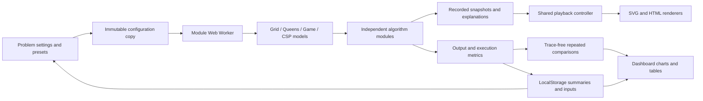

# Architecture

The worker receives a copied problem; each algorithm computes without touching the DOM. A step contains `event`, `eventIndex`, a copied lab-specific `state`, copied cumulative `metrics`, a pseudocode `line`, and a plain-language `reason`. Engines return `steps`, `status`, `metrics`, `output`, and an explicit `traceSkipped` count.

| Module | Responsibility |
| --- | --- |
| `index.html`, `styles.css` | Semantic app shell, navigation, dark responsive design, focus styles, labeled state symbols |
| `js/models.js` | Problem presets, configurations, and algorithm choices |
| `js/core.js` | Queue, stack, stable binary-heap priority queue, Xorshift32 PRNG, immutable recorder, engine timing |
| `js/algorithms/pathfinding.js` | Five explicit graph-search policies, relaxation, parent/path reconstruction |
| `js/algorithms/optimization.js` | Pair-conflict objective, steepest hill climbing, simulated annealing |
| `js/algorithms/game.js` | Legal Tic-Tac-Toe states, terminal rules, Minimax, alpha-beta, bounds and retained tree |
| `js/algorithms/csp.js` | Sudoku/timetable model adapters; shared explicit backtracking and forward-checking engine |
| `js/engine.js` | Dispatch, validation, repeated comparisons, paired trial generation and summary statistics |
| `js/worker.js` | Worker message boundary and error handling |
| `js/playback.js` | Timer, run/pause/next/previous/reset/seek/speed; algorithms never run from a playback timer |
| `js/renderers.js` | Labeled SVG grids, boards and charts; Sudoku/timetable views; pseudocode and cost inspector |
| `js/storage.js` | Versioned LocalStorage and experiment summaries |
| `js/main.js` | User events, routing, worker cancellation, dashboard composition and persistence orchestration |
| `tests/algorithms.test.js` | Independent invariants, fixtures, optimality and bounded-memory regression checks |
| `scripts/comparison-report.mjs` | Reproducible real report generation using the same engine |

## Lifecycle

Ready → Computing → Recorded/paused → Playing → Paused/completed. Reset or navigation terminates any worker and invalidates its request ID so stale replies cannot affect a new lab. Settings lock while computing or holding a trace. Inspection and playback remain available. A failed validation returns to ready and displays the actual error.

Snapshots are independent structured clones. Trace caps bound memory; the final snapshot is retained even when intermediate recording stops. Game node values have event-indexed update histories, so expanding a node while rewinding does not reveal a later backed-up value. Sparse tree retention bounds opening Minimax memory while the full search still computes exact root results.

Workers can run scripts separately from the UI thread and communicate through copied messages. Rendering and LocalStorage remain on the main thread. [MDN Web Workers](https://developer.mozilla.org/en-US/docs/Web/API/Web_Workers_API)

SVG integrates labeled geometry with the DOM, making cells, boards, and charts inspectable and responsive. HTML is used where native controls and disclosures are more accessible, including game tree expansion and puzzle entry. [MDN SVG](https://developer.mozilla.org/en-US/docs/Web/SVG)
